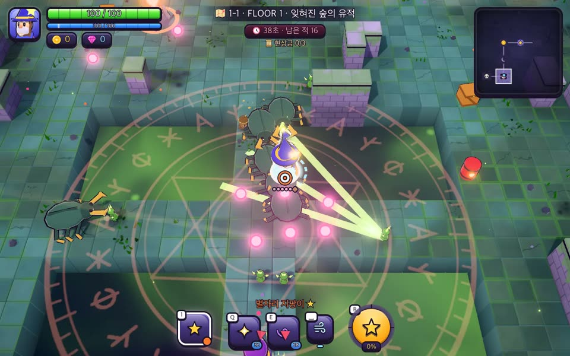
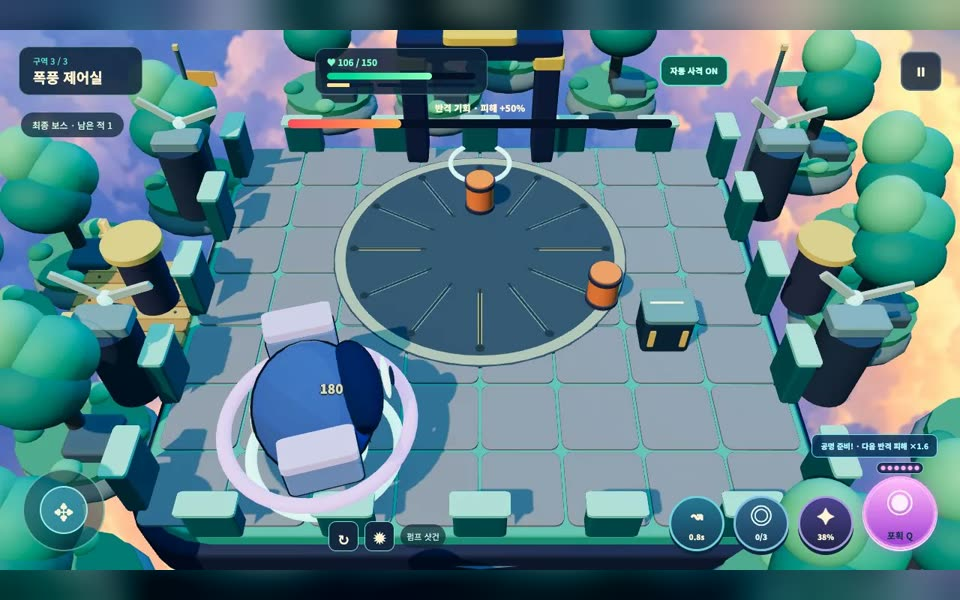
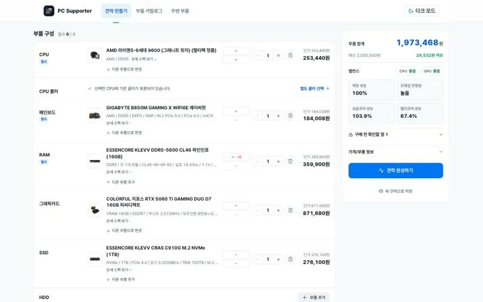
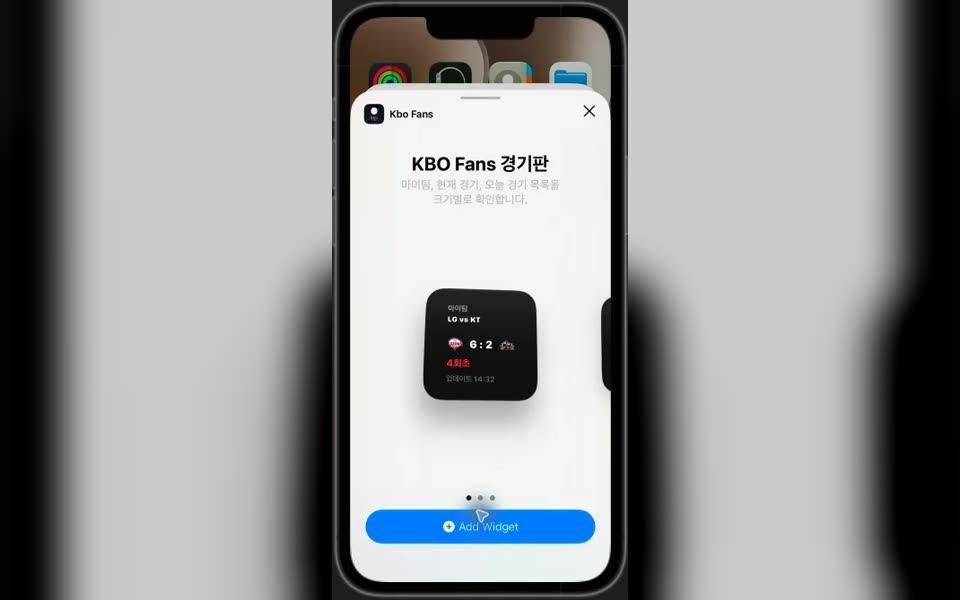
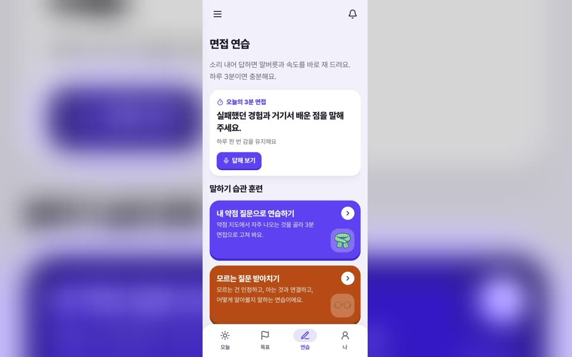
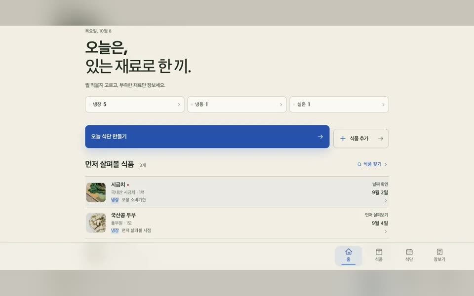

  
  
  
  

## 👋 안녕하세요

베이글코드에서 **슬롯 14종 이상**을 TypeScript 서버 로직부터 Unity 클라이언트까지 만들었습니다.
AI에 구현을 맡기기 시작한 뒤로는 기획, 구현, 검증, 출시를 혼자 끝까지 끌고 가며,
무엇을 만들고 어디로 갈지 판단하는 일에 시간을 씁니다.

<table>
  <tr>
    <td width="33%" valign="top">
      <h3>🧭 방향</h3>
      <b>제가 정합니다</b> 
      무엇을 만들지, 무엇을 버릴지, 어디가 재미없는지 판단합니다.
    </td>
    <td width="33%" valign="top">
      <h3>🤖 구현</h3>
      <b>AI가 만듭니다</b> 
      서버, 클라이언트, 앱, 배포까지 에이전트에 나눠 맡깁니다.
    </td>
    <td width="33%" valign="top">
      <h3>✅ 검증</h3>
      <b>제가 확인합니다</b> 
      "됐다는 보고"가 아니라 실행 결과로 완료를 판단합니다.
    </td>
  </tr>
</table>

<table>
  <tr>
    <td align="center" width="33%"><h2>14+</h2>서버부터 클라이언트까지 만든 슬롯</td>
    <td align="center" width="33%"><h2>6년</h2>게임 회사 경력</td>
    <td align="center" width="33%"><h2>9</h2>혼자 디렉팅한 개인 제품</td>
  </tr>
</table>

## 🎮 대표 프로젝트

<table>
  <tr>
    <td width="50%" valign="top">
      
      <h4>⚔️ 룬브레이커: 마법사의 던전</h4>
      브라우저에서 도는 3D 탑다운 핵앤슬래시 로그라이트. 밸런스 콘솔을 따로 만들어 수치를 조정했습니다.  
      <code>Three.js</code> <code>Vite</code> · <b>플레이 가능 데모</b>
    </td>
    <td width="50%" valign="top">
      
      <h4>🔁 Reactor Rush</h4>
      적탄을 붙잡아 되쏘는 3D 액션 원정 게임. PC와 터치, 세로 화면까지 같은 손맛을 내도록 다듬었습니다.  
      <code>Three.js</code> <code>TypeScript</code> · <b>플레이 가능 데모</b>
    </td>
  </tr>
  <tr>
    <td width="50%" valign="top">
      
      <h4>🖥️ <a href="https://github.com/godekd3133/pc-supporter">PC Supporter</a></h4>
      내 견적이 왜 호환되는지 근거까지 보여 주는 PC 조립 도우미. 규칙 엔진으로 판단 근거를 설명합니다.  
      <code>React</code> <code>Express</code> <code>PostgreSQL</code> · <b>라이브 베타</b>
    </td>
    <td width="50%" valign="top">
      
      <h4>⚾ <a href="https://github.com/godekd3133/kbo-fans">KBO Fans</a></h4>
      내 팀 경기를 위젯과 잠금 화면에서 바로 보는 야구 팬 앱. Live Activity와 푸시까지 혼자 만들었습니다.  
      <code>Flutter</code> <code>FastAPI</code> · <b>TestFlight 베타</b>
    </td>
  </tr>
  <tr>
    <td width="50%" valign="top">
      
      <h4>🎤 커리어센터</h4>
      공고 선택부터 면접 복기까지 잇는 취업 준비 앱. 같은 질문에 다시 답해 나아진 정도를 확인합니다.  
      <code>TypeScript</code> <code>PWA</code> <code>Electron</code> · <b>비공개 베타</b>
    </td>
    <td width="50%" valign="top">
      
      <h4>🥕 <a href="https://github.com/godekd3133/rescue-meal">Rescue Meal</a></h4>
      먼저 써야 할 재료부터 알려 주는 식재료 관리와 식단 도우미. 영수증, 바코드, 라벨로 재료를 등록합니다.  
      <code>Vite</code> <code>Python</code> <code>PostgreSQL</code> · <b>개발 중</b>
    </td>
  </tr>
</table>

<a href="https://godekd3133.github.io/projects/"><b>→ 모든 프로젝트와 체험판 보기</b></a>

## 🛠️ 기술 스택

  

  
  
  
  
  
  

| 분야 | 하는 일 |
|---|---|
| 🎮&nbsp;**게임** | 슬롯과 캐주얼 게임의 인게임, UI, 연출. 웹 3D 게임은 Three.js로, 학창 시절에는 엔진 없이 DirectX로 프레임워크를 직접 짰습니다. |
| 🎰&nbsp;**서버** | 슬롯의 서버 로직을 쓰고, 서버 응답과 클라이언트 표시가 어긋나지 않게 맞춥니다. |
| 📱&nbsp;**앱·웹** | 사내 데스크톱 앱과 개인 제품의 화면을 만듭니다. |
| 🗄️&nbsp;**인프라** | 개인 제품의 API와 데이터, 배포를 직접 운영합니다. |
| 🤖&nbsp;**AI** | 에이전트 워크플로와 개발 도구를 만들고, 실행 결과로 검증합니다. |

## 🗺️ 걸어온 길

| 시기 | |
|---|---|
| **2021&nbsp;~&nbsp;현재** | 🎰 **Bagelcode** · GS Software Engineer — Club Vegas Slots, Cash Billionaire, Jackpot Madness 슬롯 14종 이상, Pack & Clash 클라이언트, 슬롯 개발용 AI 도구 |
| **2024&nbsp;~&nbsp;현재** | 🎓 숭실대학교 미디어경영학과 — 재직과 병행, 팀 프로젝트 DangunMyth 팀장 |
| **2020&nbsp;~&nbsp;2021** | ⚔️ **나인엠인터랙티브** · Client Engineer — 카드 덱 머지 배틀의 코어 전투와 유닛 AI |
| **2018&nbsp;~&nbsp;2021** | 🏆 서울디지텍고 게임 콘텐츠과 — 전국기능경기대회 게임 부문 5위, Bright Burn G-STAR·Gamescom 전시와 출시 |

<a href="https://godekd3133.github.io/story/"><b>→ 성장 이야기 전체 보기</b></a>

## ✍️ 최근 글

<ul>
<!-- BLOG-POST-LIST:START --><li><a href="https://godekd3133.github.io/blog/2026-11-02-ai-growth-overview/">AI 도구로 일하는 방식은 어떻게 바뀌었나</a> 2026.11.02</li>
<li><a href="https://godekd3133.github.io/blog/2026-11-02-from-tech-domain-to-market-domain/">AI에 구현을 맡기면서 시장을 더 보게 됐습니다</a> 2026.11.02</li>
<li><a href="https://godekd3133.github.io/blog/2026-11-02-slot-server-client-alignment/">슬롯 개발에서 서버와 클라이언트를 맞춘 과정</a> 2026.11.02</li>
<li><a href="https://godekd3133.github.io/blog/2026-10-31-ai-verification-and-products/">검증과 병행: 완료 조건을 실행 결과로 바꾸기</a> 2026.10.31</li>
<li><a href="https://godekd3133.github.io/blog/2026-10-29-agent-benchmark/">에이전트 결과를 어떻게 믿을까: 벤치마크</a> 2026.10.29</li>
<!-- BLOG-POST-LIST:END -->
</ul>

매일 블로그 RSS에서 자동으로 갱신됩니다 · <a href="https://godekd3133.github.io/blog/">전체 글 보기</a>

## 🐍 기여 그래프

<picture>
  <source media="(prefers-color-scheme: dark)" srcset="https://raw.githubusercontent.com/godekd3133/godekd3133/output/github-snake-dark.svg">
  <source media="(prefers-color-scheme: light)" srcset="https://raw.githubusercontent.com/godekd3133/godekd3133/output/github-snake.svg">
  
</picture>

---

🎮 무엇을 만들지 고르고, 끝까지 만들어 확인합니다 · <a href="https://godekd3133.github.io/">godekd3133.github.io</a>

